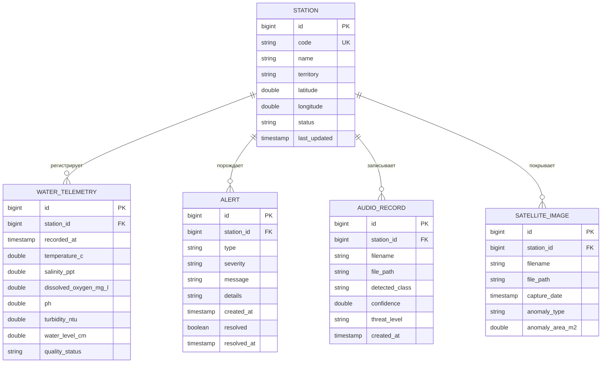

> Исторический документ прежнего прототипа. Текущий внешний ИИ и его ограничения описаны в README.md и INTEGRATION_GUIDE.md. Утверждения о встроенной модели, fallback и прежних проверках не подтверждают текущую интеграцию.

# Техническая документация Java-бэкенда «Эко-Щит Каспия»

Система раннего предупреждения и экологического мониторинга для ООПТ Каспийского региона.  
Серверная часть платформы цифрового помощника инспектора.

---

## 1. Архитектура и стек технологий

### 1.1. Технологический стек
- **Язык программирования:** Java 25 / 27 (OpenJDK)
- **Фреймворк:** Spring Boot 4.1.2
- **Сетевой уровень:** Spring Web MVC (RESTful API, Multipart file upload, CORS Filter)
- **База данных:** H2 In-Memory Database (с возможностью переключения на дисковый файл)
- **ORM / Доступ к данным:** Spring Data JPA / Hibernate 7
- **Сериализация:** Jackson JSON
- **Сборщик:** Apache Maven 3.10+

### 1.2. Слои приложения
```
  [ Frontend Web Client ]      [ IoT Sensors / Simulator ]      [ Python AI Service ]
             │                               │                             ▲
             ▼                               ▼                             │
  ┌────────────────────────────────────────────────────────────────────────┼─────┐
  │                           REST Controllers                             │     │
  │  StationController  •  WaterTelemetryController  •  AlertController   │     │
  │  AudioAnalysisController  •  ForecastController  •  SystemController   │     │
  ├────────────────────────────────────────────────────────────────────────┼─────┤
  │                            Service Layer                               │     │
  │  StationService  •  WaterTelemetryService  •  AlertService             │     │
  │  AudioAnalysisService (w/ AI Client & Fallback) • ForecastService      ▼     │
  ├──────────────────────────────────────────────────────────────────────────────┤
  │                       Repository Layer (Spring Data JPA)                     │
  │  StationRepository  •  WaterTelemetryRepository  •  AlertRepository         │
  │  AudioRecordRepository  •  SatelliteImageRepository                         │
  ├──────────────────────────────────────────────────────────────────────────────┤
  │                            In-Memory DB (H2)                                 │
  └──────────────────────────────────────────────────────────────────────────────┘
```

---

## 2. Модель данных и ER-диаграмма



---

## 3. Спецификация REST API

Базовый URL: `http://localhost:8080`

### 3.1. Модуль станций мониторинга (`/api/stations`)

#### `GET /api/stations`
Возвращает список всех станций мониторинга с координатами, текущим экологическим статусом и последними показателями.
- **Ответ `200 OK`**:
```json
[
  {
    "id": 1,
    "code": "BUOY-DAM-01",
    "name": "Буй Дамчикский №1",
    "territory": "Дельта Волги — Дамчикский участок (Астраханский биосферный заповедник)",
    "latitude": 45.7825,
    "longitude": 47.9234,
    "status": "NORMAL",
    "lastUpdated": "2026-11-12T13:45:00",
    "latestReading": {
      "temperatureC": 12.4,
      "salinityPpt": 0.8,
      "dissolvedOxygenMgL": 8.6,
      "ph": 7.8,
      "turbidityNtu": 14.2,
      "waterLevelCm": 265.0
    }
  }
]
```

#### `GET /api/stations/{id}`
Детальная информация по станции по её числовому ID.
- **Ответ `200 OK`** / `404 Not Found`.

#### `POST /api/stations`
Создание новой станции или регистрация нового автономного буя.
- **Запрос:**
```json
{
  "code": "BUOY-ISL-06",
  "name": "Морской буй 'Остров Чечень' №6",
  "territory": "Северо-Западный Каспий",
  "latitude": 43.9521,
  "longitude": 47.7410
}
```
- **Ответ `201 Created`**.

---

### 3.2. Модуль телеметрии воды (`/api/telemetry/water`)

#### `POST /api/telemetry/water`
Приём свежего измерения с датчиков. Выполняет автоматическую проверку граничных значений и при выявлении угрозы немедленно генерирует предупреждение (`Alert`).
- **Запрос:**
```json
{
  "stationId": 1,
  "temperatureC": 13.1,
  "salinityPpt": 1.1,
  "dissolvedOxygenMgL": 3.4,
  "ph": 7.4,
  "turbidityNtu": 18.5,
  "waterLevelCm": 250.0,
  "recordedAt": "2026-11-12T14:15:00"
}
```
*(поле `recordedAt` опционально, по умолчанию выставляется текущее серверное время)*
- **Ответ `201 Created`**:
```json
{
  "id": 142,
  "stationId": 1,
  "stationCode": "BUOY-DAM-01",
  "recordedAt": "2026-11-12T14:15:00",
  "temperatureC": 13.1,
  "salinityPpt": 1.1,
  "dissolvedOxygenMgL": 3.4,
  "ph": 7.4,
  "turbidityNtu": 18.5,
  "waterLevelCm": 250.0,
  "qualityStatus": "CRITICAL",
  "generatedAlertsCount": 1
}
```

#### `GET /api/telemetry/water/station/{stationId}`
Получение истории показателей конкретной станции для отрисовки графиков во фронтенде.
- **Параметры:**
  - `limit` (int, default: 50, max: 500)
- **Ответ `200 OK`**: список объектов измерений, отсортированных по дате (от новых к старым).

#### `GET /api/telemetry/water/latest`
Последние снятые показатели по каждой зарегистрированной станции.
- **Ответ `200 OK`**.

---

### 3.3. Модуль предупреждений и инцидентов (`/api/alerts`)

#### `GET /api/alerts`
Список алертов системы для дашборда и карты инспектора.
- **Параметры фильтрации:**
  - `resolved` (boolean, опционально): `false` — только активные, `true` — обработанные.
  - `severity` (string, опционально): `CRITICAL`, `WARNING`, `INFO`.
  - `stationId` (long, опционально).
- **Ответ `200 OK`**:
```json
[
  {
    "id": 12,
    "stationId": 1,
    "stationCode": "BUOY-DAM-01",
    "stationName": "Буй Дамчикский №1",
    "type": "HYDRO_LOW_OXYGEN",
    "severity": "CRITICAL",
    "message": "Критическое падение растворенного кислорода: 3.4 мг/л (норма > 6.0 мг/л)",
    "details": "Опасность заморных явлений и гибели молоди осетровых рыб в протоке",
    "createdAt": "2026-11-12T14:15:00",
    "resolved": false,
    "resolvedAt": null
  }
]
```

#### `PATCH /api/alerts/{id}/resolve`
Подтверждение отработки алерта инспектором ООПТ.
- **Ответ `200 OK`**: обновленный алерт с `resolved: true` и меткой времени `resolvedAt`.

---

### 3.4. Модуль гидрофонов и акустической аналитики ООПТ (`/api/audio`)

Система подключается к полевым гидроакустическим комплексам, установленным на буях и донных станциях заповедников.

#### `GET /api/audio/devices`
Получение реестра полевых регистрирующих комплексов и гидрофонов ООПТ.
- **Ответ `200 OK`**: список `RecordingDeviceDto`:
  - `deviceId`: идентификатор (`DEV-CASP-03`, `DEV-DAM-01`, `DEV-TRE-02`, `DEV-AGR-04`, `DEV-TUL-05`)
  - `name`: наименование комплекса
  - `stationId`, `stationCode`, `stationName`: привязка к посту
  - `status`: `ONLINE` / `STANDBY`
  - `batteryLevel`: заряд аккумулятора в процентах
  - `signalStrength`: уровень радиоканала (`-64 dBm LoRaWAN/4G`)
  - `hydrophoneModel`: физическая модель акустического сенсора
  - `noiseFloorDb`: фоновый уровень шума акватории в децибелах
  - `sentryActive`: флаг активного режима охраны

#### `GET /api/audio/devices/{deviceId}`
Получение телеметрии и параметров конкретного полевого устройства.

#### `POST /api/audio/devices/{deviceId}/capture`
Прямой цифровой захват и нейросетевой анализ аудиопотока с гидрофона ООПТ.
- **Query-параметры:**
  - `scenario` (опционально: `boat`, `shot`, `splash`, `ambient`) — моделирование оперативной обстановки в акватории датчика
- **Ответ `200 OK`**: `AudioAnalysisResponse` с вердиктом модели, вероятностью, уровнем угрозы и ID созданного алерта при фиксации браконьерства.

#### `GET /api/audio/devices/{deviceId}/stream`
Прямой потоковый аудиоэфир с гидроакустического буя (`audio/wav`, PCM 16-bit 44.1 kHz). Воспроизводится в браузере и визуализируется на спектрограмме.

#### `POST /api/audio/devices/{deviceId}/toggle-sentry`
Переключение сторожевого дежурного режима гидроакустического комплекса (Сторож ВКЛ/ВЫКЛ).

#### `POST /api/audio/upload`
Загрузка звуковой записи с полевого терминала инспектора (микрофон Web Audio API) или ручная загрузка аудиофайла (`multipart/form-data`).  
Бэкенд сохраняет аудио, обращается к микросервису Участника 3 (с отказоустойчивым Fallback), сохраняет результаты распознавания в базу данных и при обнаружении мотора лодки или выстрела автоматически генерирует алерт `ACOUSTIC_BOAT_DETECTED` / `ACOUSTIC_GUNFIRE`.
- **Form-Data:**
  - `file`: бинарный аудиофайл (`.wav`, `.mp3`)
  - `stationId`: ID станции
- **Ответ `200 OK`**:
```json
{
  "audioId": 5,
  "stationId": 3,
  "stationName": "Морской буй 'Северный Каспий' №3",
  "filename": "hydrophone_sample_12.wav",
  "detectedClass": "boat_engine",
  "confidence": 0.93,
  "threatLevel": "HIGH",
  "analysisSource": "Прямой поток с устройства DEV-CASP-03 (Teledyne RESON TC4032 Marine)",
  "alertGenerated": true,
  "alertId": 15
}
```

---

### 3.5. Модуль прогнозирования нереста (`/api/forecast`)

#### `GET /api/forecast/spawning`
Запрос прогноза миграции и условий нереста для выбранного вида рыб (по умолчанию — Русский осётр *Acipenser gueldenstaedtii*) на основе накопленной гидрологической телеметрии.
- **Параметры:**
  - `species` (string, опционально, default: `russian_sturgeon`)
  - `stationId` (long, опционально)
- **Ответ `200 OK`**:
```json
{
  "species": "Русский осётр (Acipenser gueldenstaedtii)",
  "targetZone": "Дельта Волги — Дамчикский участок",
  "calculationDate": "2026-11-12T14:30:00",
  "suitabilityIndex": 84.5,
  "status": "FAVORABLE",
  "windowStart": "2026-11-15",
  "windowEnd": "2026-11-22",
  "hydrologySummary": {
    "currentTemperatureC": 12.4,
    "optimalTemperatureRange": "12.0 - 16.0 °C",
    "currentSalinityPpt": 0.8,
    "floodLevelStatus": "Высокий паводковый горизонт"
  },
  "patrolRecommendation": "Высокая вероятность захода производителей осетра на нерестилища. Рекомендуется превентивное ночное патрулирование проток Быстрая и Кулагинский банк.",
  "modelType": "Hydrological Spawn Prediction Model (Participant 3 AI pipeline)"
}
```

---

## 4. Логика пороговых значений и детекции экологических угроз

Сервис `WaterTelemetryService` автоматически оценивает поступающие значения:

| Показатель | Нормальный диапазон | Порог тревоги | Порог критический | Тип генерируемого алерта |
|---|---|---|---|---|
| **Растворенный кислород ($O_2$)** | 6.0 – 12.0 мг/л | 4.0 – 6.0 мг/л | < 4.0 мг/л | `HYDRO_LOW_OXYGEN` (CRITICAL) |
| **Солёность (в дельте)** | 0.1 – 3.0 ‰ | 3.0 – 8.0 ‰ | > 8.0 ‰ | `HYDRO_HIGH_SALINITY` (WARNING) |
| **Водородный показатель ($pH$)** | 6.8 – 8.5 | 6.0 – 6.8 / 8.5 – 9.0 | < 6.0 или > 9.0 | `HYDRO_ABNORMAL_PH` (WARNING) |
| **Мутность** | < 25 NTU | 25 – 60 NTU | > 60 NTU | `HYDRO_HIGH_TURBIDITY` (INFO) |
| **Уровень воды** | 200 – 350 см | < 150 см (обсыхание) | < 120 см / > 400 см | `HYDRO_CRITICAL_LEVEL` (WARNING) |

Если хотя бы один параметр находится в критической зоне, общий статус станции меняется на `CRITICAL`, загорается красный индикатор на карте инспектора, а в ленту событий падает соответствующий `Alert`.

---

## 5. Инструкция по запуску и тестированию

### 5.1. Требования
- JDK 21, 25 или 27
- Apache Maven 3.9+

### 5.2. Сборка и запуск
Из папки `demo/`:
```bash
# Компиляция и запуск в оффлайн-режиме
mvn clean compile
mvn spring-boot:run
```

Сервер запускается на порту `8080`.  
H2 консоль доступна по адресу: `http://localhost:8080/h2-console` (JDBC URL: `jdbc:h2:mem:ecoshield_db`, User: `sa`, Password: *(пусто)*).

### 5.3. Примеры запросов для проверки (cURL)

**1. Получить список станций:**
```bash
curl -X GET http://localhost:8080/api/stations
```

**2. Отправить телеметрию с критическим падением кислорода:**
```bash
curl -X POST http://localhost:8080/api/telemetry/water \
  -H "Content-Type: application/json" \
  -d '{
    "stationId": 1,
    "temperatureC": 12.5,
    "salinityPpt": 0.9,
    "dissolvedOxygenMgL": 3.2,
    "ph": 7.4,
    "turbidityNtu": 15.0,
    "waterLevelCm": 260.0
  }'
```

**3. Проверить появившийся алерт:**
```bash
curl -X GET http://localhost:8080/api/alerts?resolved=false
```

**4. Подтвердить отработку алерта:**
```bash
curl -X PATCH http://localhost:8080/api/alerts/1/resolve
```

